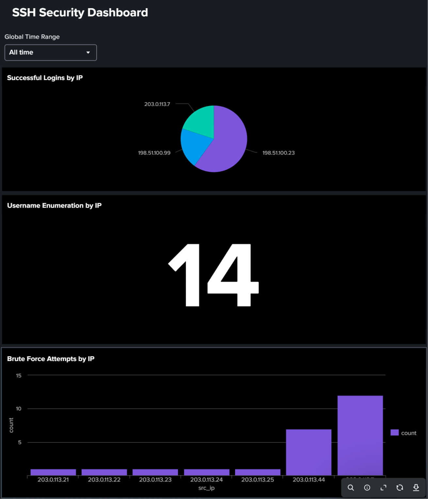

# SSH Security Dashboard

A small Splunk lab that turns SSH logs into a working SIEM dashboard. I took the sample SSH log from my log analyzer project, indexed it in Splunk Enterprise, and built three searches that show the attacks in it.

The log file is `sample_auth.log` from [cyber-log-analyzer](https://github.com/uman-ranjha/cyber-log-analyzer). It has 36 auth events: 5 accepted logins and 31 failed or invalid attempts. All of the IP addresses are sample addresses, not real attackers.

## Dashboard

The dashboard has three panels.

1. Successful Logins by IP, Pie Chart. It shows who logged in and how often.
2. Username Enumeration by IP, Single Value. It shows how many times an attacker tried usernames that do not exist.
3. Brute Force Attempts by IP, Column Chart. It shows failed password attempts grouped by IP.

## What the logs show

### Brute force from 203.0.113.7

This IP made 12 failed password attempts in about 5 minutes, from 14:02 to 14:07 on Oct 23. It tried root, admin, test, and ubuntu. It then logged in as root at 14:09, after those 12 failures. Treat that as a possible compromise until it is checked.

### Username enumeration from 203.0.113.44

This IP tried 7 usernames that do not exist: oracle, test, guest, postgres, mysql, nagios, and zabbix. The Invalid user search returns 14 events for this IP, because it matches both the Invalid user lines and the Failed password for invalid user lines.

### Password spraying against jdoe

Five different IPs tried the same user, jdoe, once each: 203.0.113.21, 203.0.113.22, 203.0.113.23, 203.0.113.24, and 203.0.113.25. That is the classic spray pattern. It spreads the attempts out so a simple per IP limit does not catch it.

### Successful logins

There were 5 accepted logins in total.

- 198.51.100.23, 3 times, for uman. This is normal use.
- 198.51.100.99, 1 time, for uman at 03:12. This is an off hours login worth checking.
- 203.0.113.7, 1 time, for root. This is the attacker login from the brute force above.

## How to build it

1. Install Splunk Enterprise on your own PC and log in at http://localhost:8000.
2. Download `sample_auth.log` from the cyber-log-analyzer repo.
3. In Splunk, go to Settings, Add Data, Monitor, Files and Directories. Point it at the log file and choose Index Once.
4. On the Set Source Type step, set the source type to `linux_secure`.
5. Run the searches in `searches.spl`. Set the time range to All time, because the logs are from Oct 23.
6. Save each search as a dashboard panel. Use the titles in `searches.spl`.

## Searches

All three searches are in `searches.spl`. They are the same searches the dashboard panels use.
